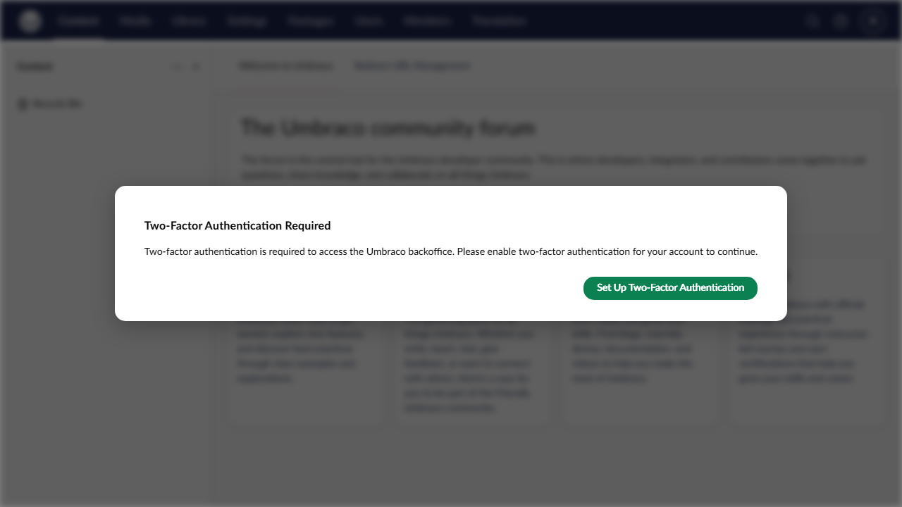
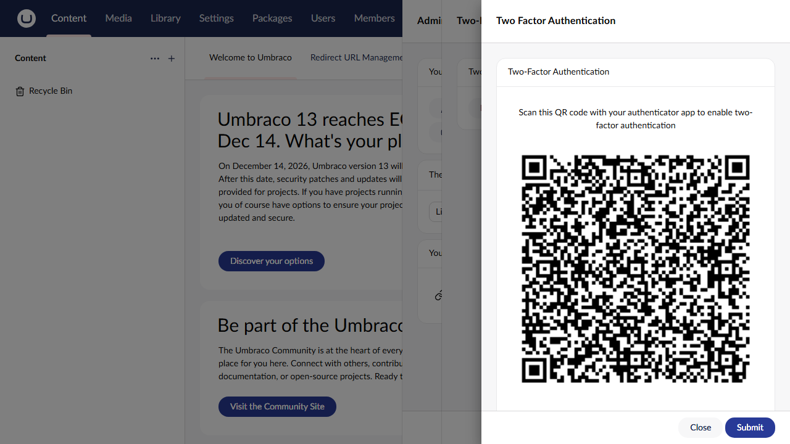
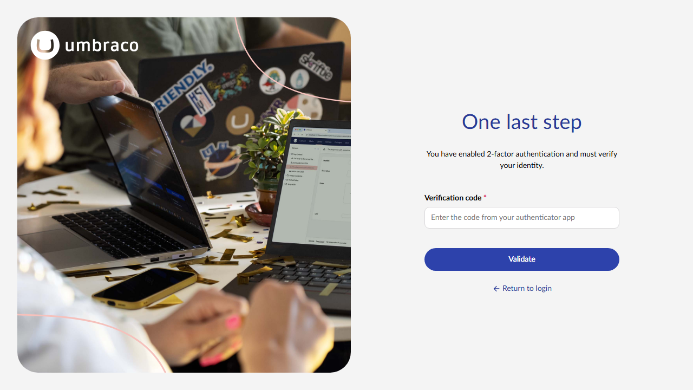

# PunkTwoFactor

[](https://www.nuget.org/packages/Umbraco.Community.PunkTwoFactor/)
[](https://www.nuget.org/packages/Umbraco.Community.PunkTwoFactor/)
[](https://github.com/garpunkal/Umbraco.Community.PunkTwoFactor/actions/workflows/ci.yml)
[](LICENSE)

Two-Factor Authentication (2FA) for Umbraco backoffice users.

This package adds standard TOTP authenticator app support (Google Authenticator, Microsoft Authenticator, 1Password, etc.) to the Umbraco backoffice. It registers itself automatically on startup via an Umbraco `IComposer`, with no code changes required.

---

## Getting Started

Install the package from NuGet:

```shell
dotnet add package Umbraco.Community.PunkTwoFactor
```

Once installed, users can enable 2FA from their profile in the Umbraco backoffice:

1. Log in to the Umbraco backoffice.
2. Click your user avatar in the top-right corner and select **Configure Two-Factor**.
3. Click **Enable** on **Two Factor Authentication**.
4. Scan the QR code with your authenticator app and enter the 6-digit verification code.

---

## Configuration

You can optionally configure `Umbraco.Community.PunkTwoFactor` via your `appsettings.json` file.

### Custom Issuer & Provider Name

By default, the issuer name shown in authenticator apps is `"Umbraco Two Factor Authentication"`. You can customize it in `appsettings.json`:

```json
{
    "Umbraco.Community.PunkTwoFactor": {
        "Issuer": "garpunkal.dev",
        "ProviderName": "Two Factor Authentication"
    }
}
```

### Force Two-Factor Authentication

By default, 2FA is opt-in per user. To require 2FA for all backoffice users, set `ForceTwoFactor` to `true`:

```json
{
    "Umbraco.Community.PunkTwoFactor": {
        "ForceTwoFactor": true,
        "ExemptUserGroups": ["writer"]
    }
}
```

- **Behavior:** Users without 2FA enabled are prompted immediately on login with a **"Two-Factor Authentication Required"** dialog that takes them straight to QR code setup. Management API endpoints return `403 Forbidden` and the **Disable** button is hidden until 2FA is enabled.
- **Exemptions:** Optionally list Umbraco user group aliases in `ExemptUserGroups` to exclude specific groups from `ForceTwoFactor`.
- **Live toggle:** Changes to `ForceTwoFactor` in `appsettings.json` are picked up automatically without restarting the site.

---

## Compatibility

- Umbraco 17, 18, and 19 (RC2+)
- .NET 10 and .NET 11

---

## Screenshots

### Forced 2FA Prompt



### QR Code Setup



### 2FA Login Verification



---

> **Disclaimer:** Use this package at your own risk. It is provided "as is", without warranty of any kind. You are solely responsible for the security, configuration, and testing of your website and Umbraco installation.

